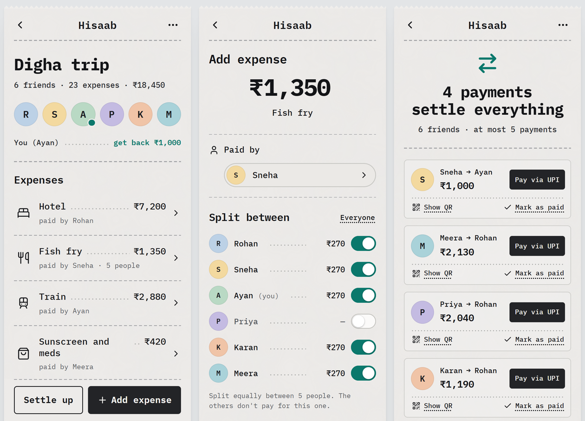

# Hisaab

**Split a trip with friends. Settle it in a few UPI payments.**

Everyone joins the trip from one link and adds what they paid. Didn't eat the pizza? Leave yourself out of that one. At the end, Hisaab nets out who owes what and lists the payments that square everyone: **never more than one fewer than the number of people** (6 friends, 5 payments at most). Each payment is a UPI link with the amount filled in, plus a QR code.

No sign-up, no app to install, no ads. Open source, so you can host your own copy for free.

**Use it:** https://souradip121.github.io/hisaab/



---

## How the maths works

1. **Equal split, paise-exact.** Every amount is stored as whole paise. An expense of ₹100 split 3 ways is ₹33.34 + ₹33.33 + ₹33.33: the leftover paise go to the first people in the trip's join order, so shares always add back up to the bill.
2. **Net balances.** For each person: what they paid − their share of everything + payments they've sent − payments they've received. The balances always add up to exactly ₹0 (the app shows this under Balances).
3. **Greedy settle-up.** First, anyone who owes exactly what someone else is owed pays them directly. Then the biggest debtor pays the biggest creditor until one of them is square, and repeat. Every payment squares at least one person and the last one squares two, so **n people never need more than n − 1 payments**.

This is usually close to the fewest payments possible, but it is **not guaranteed to be the minimum** (finding the true minimum is a much harder problem). The app never claims it is.

"Mark as paid" records a payment, so the remaining cards recalculate. Undo is one tap.

The maths lives in [`assets/js/settle.js`](assets/js/settle.js) (no dependencies) and is tested in [`tests/settle.test.mjs`](tests/settle.test.mjs): thousands of random trips, including 300 trips of 6 people with 23 expenses, checking that balances add to zero, every transfer is positive whole paise, nobody pays themselves, there are at most n − 1 transfers, and paying them all leaves everyone at ₹0.

## How your data is protected

- **The link is the key.** Creating a trip makes a secret token (24 random bytes, 32 characters) that lives after the `#` in the invite link. Browsers never send that part of a URL to the web host. Anyone with the link can see and edit that trip, so share it only with the people on the trip.
- **The browser can't read any table.** Every `hs_` table has row-level security switched on with no policies, and the public `anon` role has no table privileges at all. A direct `GET /rest/v1/hs_trips` returns 401.
- **Everything goes through functions that need the token.** The app calls `hs_get_trip`, `hs_add_expense` and friends. They're `SECURITY DEFINER` Postgres functions that look the trip up by its token and only ever touch that trip's rows. One trip's token can't reach another trip's members or expenses.
- **Live updates leak nothing.** Phones poll `hs_trip_version(token)` and refetch only when it changes. They also listen on a Supabase Realtime *Broadcast* channel named after a SHA-256 hash of the token; a write sends a data-free "changed" ping there. If Realtime is off, polling alone keeps everyone in sync within a few seconds.
- **What's stored:** the trip name, people's names, optional UPI IDs, expenses and recorded payments. No accounts, emails, phone numbers, cookies or analytics. The app remembers which trips you're on in your browser's local storage.

## Host your own copy (free, about 10 minutes)

You need a GitHub account and a free [Supabase](https://supabase.com) account.

1. **Fork this repo** (or download it).
2. **Create a Supabase project** (free plan is fine). Any region; pick the one closest to your friends.
3. **Create the tables and functions.** In the Supabase dashboard open **SQL Editor**, paste the whole of [`schema.sql`](schema.sql) and press **Run**. It only creates objects whose names start with `hs_`, and it's safe to run again. It can share a project with other apps.
4. **Point the app at your project.** In the dashboard go to **Project Settings → API** and copy the **Project URL** and the **anon public** key into [`config.js`](config.js). Never put the `service_role` key there: the anon key is meant to be public, the service key is not.
5. **Publish it.**
   - **GitHub Pages:** repo **Settings → Pages → Build and deployment → Deploy from a branch**, branch `main`, folder `/ (root)`. Your app appears at `https://<you>.github.io/hisaab/` a minute later.
   - **Netlify or Vercel:** import the repo. There's no build step: leave the build command empty and the publish directory as the repo root.

Then check everything works against your project:

```bash
npm test                 # settlement maths (Node 18+, no installs)
npm run check:live       # 28 checks against your Supabase project, using only the anon key
npm run seed:demo        # optional: creates a demo "Digha trip" and prints its link
```

`check:live` creates two small trips named `live-check …`. Remove them afterwards in the SQL Editor:

```sql
delete from public.hs_trips where name like 'live-check %';
```

To run the site locally, serve the folder with any static server, e.g. `python -m http.server 8000`, and open http://localhost:8000.

## Free-tier notes

Limits as of late 2026; check [supabase.com/pricing](https://supabase.com/pricing) for current numbers.

- **Database size:** the free plan's 500 MB is plenty. A trip with 6 people and 25 expenses is a few kilobytes, so even a whole college's trips won't come close.
- **Pausing:** free projects pause after about a week with no activity. A paused project shows "The server is waking up" in the app. To wake it, open the project in the Supabase dashboard and press **Restore project**; it takes a couple of minutes.
- **Realtime:** the free plan allows a few hundred simultaneous connections. If you go over, the live ping stops but polling keeps every phone in sync.
- **Abuse:** anyone can create trips with your anon key (that's how the app works). Each trip is capped at 30 people, 500 expenses and 500 payments, and every text field has a length limit. If someone spams your project, you can delete trips from the SQL Editor.
- **Hosting:** GitHub Pages, Netlify and Vercel all host a static site like this for free.

## Paying through UPI

Each settle-up card has a **Pay via UPI** button that opens a `upi://pay?pa=…&pn=…&am=…&cu=INR&tn=…` link: the payee's UPI ID, their name, the amount and the trip name are filled in. The button only appears when the person being paid has added a UPI ID (anyone on the trip can add or fix it).

- Some UPI apps refuse prefilled payments to personal UPI IDs, or ask you to confirm the amount again. If yours does, tap **Show QR** and scan it from another phone, or copy the UPI ID and pay manually.
- Links inside Instagram's or other apps' built-in browsers may not open UPI apps. Open the trip in Chrome or Safari instead.
- Hisaab never touches money. Marking a card as paid is just a note for the group, so only mark it once the payment has gone through.

## Project layout

```
index.html               the app shell
config.js                your Supabase URL + anon key (nothing else)
schema.sql               tables, RLS, functions (all hs_*)
assets/js/settle.js      the money maths (pure, tested)
assets/js/app.js         screens and routing
assets/js/api.js         calls the hs_* functions over PostgREST
assets/js/live.js        polling + Realtime Broadcast ping
assets/js/barcode.js     a real Code 128 barcode of the trip name
assets/css/hisaab.css    the receipt
tests/settle.test.mjs    unit tests (node --test)
scripts/                 live check, demo seed
```

## Credits

- Type: [IBM Plex Mono](https://github.com/IBM/plex) (SIL Open Font License, see `assets/fonts/OFL-IBM-Plex.txt`), subset to the characters the app uses.
- Icons: path data from [Lucide](https://lucide.dev) (ISC licence); the train and receipt icons are drawn for this app.
- QR codes: [qrcode-generator](https://github.com/kazuhikoarase/qrcode-generator) by Kazuhiko Arase (MIT).

Made by [@souradip.sh](https://www.instagram.com/souradip.sh/). MIT licensed, see [LICENSE](LICENSE).
